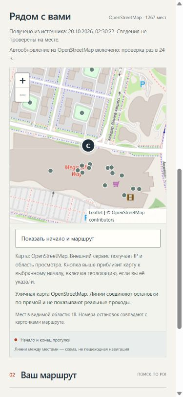

# Astana Walks

ИИ-помощник по прогулкам в Астане для задачи №1 НИЦ Smart City, Build with AI / GDG Astana.

Выберите старт, интересы и запас времени. Приложение подбирает до трёх реальных мест, объясняет выбор и предлагает занятие. Время включает возвращение к старту. Карточки содержат источники и предупреждения о неизвестных свойствах.

Бюджет прогулки — от 10 минут до 8 часов. В поле «Есть время» доступны быстрые варианты и «Своё время» для целого числа минут, например 375 (6 часов 15 минут). Это верхняя граница, а не обещанная длительность маршрута: подбор по-прежнему предлагает до трёх остановок и может занять меньше времени.

Готовые исходники и материалы находятся в [`main`](https://github.com/ltybcs/astana-walks-ai/tree/main); история интеграции — [PR #5](https://github.com/ltybcs/astana-walks-ai/pull/5). [Временное HTTPS-демо](https://entire-burn-cricket-ashley.trycloudflare.com/) работает, пока включены ПК, приложение и туннель. Фактический режим ответа виден в интерфейсе; при ошибке или отклонении текста LLM используется обозначенный extractive fallback.

| Возможность | Что реализовано |
| --- | --- |
| Каталог | 1267 объектов OpenStreetMap; raw, запрос, даты, SHA-256 и атрибуция сохранены |
| Реальная карта | Leaflet 1.9.4, улицы OSM, старт, номера мест и масштабирование |
| Обновление | Opt-in worker с TTL 24 часа и последним пригодным снимком при сбое |
| 2ГИС | Отдельный живой поиск по категории, до 10 карточек; 20 попыток за скользящие 24 часа |
| Локальная модель | Закреплённая Qwen3-4B-Instruct-2507 Q4_K_M через llama.cpp, без облачного ключа |
| Телефон | PWA; установка и запуск по иконке в Android Chrome подтверждены пользователем |



## Быстрый старт

Нужен Python 3.11+. Приложение использует стандартную библиотеку; Node.js и установка Python-пакетов для запуска не нужны. Leaflet поставляется локально.

```sh
git clone https://github.com/ltybcs/astana-walks-ai.git
cd astana-walks-ai
python -m app.server --data data/poi.astana.json
```

Репозиторий закрытый, для клонирования нужен доступ. Для полученного ZIP достаточно последней команды из папки проекта. Откройте [http://127.0.0.1:8000](http://127.0.0.1:8000). Без модели работает extractive-режим; сервер по умолчанию слушает только этот компьютер.

## Локальная LLM

Для Windows x64 подготовлен CPU-запуск **Qwen3-4B-Instruct-2507 Q4_K_M** через **llama.cpp b11739**. GGUF опубликован Unsloth на основе Qwen, лицензия Apache-2.0. Runtime и веса закреплены по версии и SHA-256. Веса около 2,5 ГБ загружаются отдельно и не входят в Git/архив.

```sh
python scripts/setup_local_llm.py --download
python scripts/run_demo.py --data data/poi.astana.json --local-llm --refresh-poi
```

Сначала остановите прежний сервер на порту 8000. Launcher поднимает приложение на `127.0.0.1:8000`, модель на `127.0.0.1:8081` и завершает оба процесса по Ctrl+C. `--refresh-poi` включает обновление; без флага используется локальный снимок.

На Linux/macOS или с другой моделью запустите совместимый Chat Completions API самостоятельно. Внешнему HTTPS endpoint нужен `LLM_API_KEY`; для loopback ключ не требуется. `.env` автоматически не читается. Пример PowerShell для отдельного терминала приложения или оценки:

```powershell
$env:LLM_BASE_URL = 'http://127.0.0.1:8081/v1'
$env:LLM_MODEL = 'astana-local'
$env:LLM_JSON_MODE = 'schema'
$env:LLM_TOKEN_PARAMETER = 'max_tokens'
$env:LLM_TIMEOUT_SECONDS = '120'
```

Поддерживаются `LLM_JSON_MODE=schema/json/none` и `LLM_TOKEN_PARAMETER=max_tokens/max_completion_tokens`. Модель получает распознанные интересы и публичные факты POI, без исходного текста запроса и точных координат старта. Backend проверяет структуру, ID, ссылки, числа и известные рискованные утверждения; разрешена одна ограниченная попытка исправления. Эти проверки не гарантируют смысловую корректность будущего ответа.

## Карта, данные и обновление

`data/poi.astana.json` содержит **1267 объектов источника** в bbox `51.00,71.20,51.32,71.70`: все 738 прежних ID и 529 новых. 789 объектов имеют имя; ещё 478 парков/площадок явно подписаны «Без названия: категория (OSM тип/ID)». Собственные имена не выдумываются. Это ограниченная городская область, не административная граница и не полный каталог. Retrieval дополнительно убирает физические дубли.

Дата базы OSM — `2026-10-19T21:29:20Z`, получение — `2026-10-19T21:30:22Z`. Raw, запрос, SHA и нормализация описаны в [data/SOURCES.md](data/SOURCES.md). Неизвестные часы, розетки, тишина и доступность остаются неизвестными; полевой проверки нет.

Карта показывает реальные улицы. Номера маркеров соответствуют карточкам; пунктир соединяет POI и старт по прямой. Время оценивается геометрически с коэффициентом и возвратом, без дорожного графа, переходов и ограждений. Для прохода нужен навигатор. При сбое тайлов список продолжает работать.

OSM tile service получает IP и область просмотра. Общий городской вид загружается сразу; ручной/GPS-старт не приближает карту без отдельной кнопки после уведомления. Геолокация запрашивается только по кнопке. Нет предварительной выгрузки города и офлайн-пакетов тайлов. Лицензия Leaflet и проверенные upstream SHA/SRI — в `web/vendor/leaflet/1.9.4/`.

```sh
python scripts/refresh_poi.py
python -m app.server --data data/poi.astana.json --refresh-poi
python scripts/collect_osm.py --output tmp/poi.candidate.json
```

Worker использует TTL 24 часа от `collected_at`, ограниченный повтор и часовой cooldown после ошибки. Он не запускается пользовательским поиском. Новый JSON и индекс проверяются до атомарной замены; при сбое остаётся прежняя версия. Cache/raw/state — в игнорируемой `.local/poi/`; shipped-файл не перезаписывается. `/api/health` показывает возраст, источник shipped/cache и сроки обновления. Персональные запросы и координаты в Overpass не отправляются.

Данные требуют [© OpenStreetMap contributors, ODbL](https://www.openstreetmap.org/copyright), карта — видимой атрибуции. Лицензии данных, Leaflet и модели не являются лицензией кода проекта.

## Живой поиск 2ГИС

Отдельная панель возвращает одну страницу до 10 карточек выбранной категории со ссылками и атрибуцией. Карточки не включаются в OSM-каталог, контекст LLM или маркеры карты. Размер страницы демо-ключа ограничен 10: [документация](https://docs.2gis.com/en/api/search/places/examples/results).

Для своего экземпляра задайте официальный ключ в `DGIS_API_KEY` окружения backend либо сохраните только значение в игнорируемом файле `.local/2gis/api-key`. Без ключа панель сообщает о недоступности. Ключ не передаётся браузеру, в Git или материалы сдачи.

Лимит приложения — **20 попыток за скользящие 24 часа** на весь экземпляр, включая ошибки. Попытка резервируется до сети и сохраняется между перезапусками; запросы последовательные, без повторов. Отправляются только категория и постоянный bbox Астаны, без пользовательского текста/локации. Лимиты аккаунта провайдера действуют дополнительно.

По [п. 3.1 опубликованной оферты](https://law.2gis.ru/webapi-offer) кеширование не предусмотрено. Ответы имеют `no-store` и не записываются на диск, в Git, ZIP или service worker; сохраняются только времена попыток. Реальный поиск кафе проверен: 10 карточек и 10 ссылок. `output/2gis-check.json` содержит только метаданные, без записей и ключа. Другие категории этим не сертифицированы.

`scripts/collect_2gis.py` оставлен для договоров с явно разрешённым хранением. В демо реальная выгрузка 2ГИС не используется. [Подробности](data/SOURCES.md).

## Установка на телефон

Откройте HTTPS-демо во внешнем браузере и нажмите «Установить». Если системное окно недоступно, приложение показывает ручную инструкцию.

- Android Chrome: предложение установки или меню браузера.
- Android Firefox: установка/добавление на домашний экран, название зависит от версии. [Инструкция Mozilla](https://support.mozilla.org/ru/kb/ispolzovanie-veb-prilozhenij-s-firefox-dlya-androi).
- iPhone Safari: «Поделиться» → «На экран “Домой”».

Пользователь подтвердил установку и запуск по иконке в Android Chrome (`output/phone-check.json`). Firefox, iPhone и offline на физическом устройстве не подтверждены. Мобильные скриншоты сделаны в браузерном viewport и не выдаются за запись телефона.

PWA сохраняет статическую оболочку. API, запросы, координаты, рекомендации и cross-origin тайлы service worker не кеширует. Новый подбор требует связи с backend. [Приватность](docs/PRIVACY.md), [HTTPS](docs/HTTPS_DEMO.md).

## Проверки и контейнер

```sh
python -m unittest discover -s tests -v
python -m app.evaluate --data data/poi.astana.json --output tmp/evaluation-extractive.json
```

Node.js в PATH нужен для JS-проверок карты/PWA; без него они отмечаются пропущенными. Основные пять сценариев проверяют время с возвратом, источники, ограничения, дубли и объяснённый отказ. Семейный UI-пресет проверяется отдельно. Формальный PASS отделён от чтения свободных `why/action`.

Текущий suite: **131/131, без пропусков**. В принятом LLM-протоколе пройдены 5/5 основных сценариев и дополнительный семейный пресет; все восемь пар объяснений/действий прочитаны двумя агентами. Четыре основных ответа повторно проверены новым guard без генерации, семейный ответ получен отдельно. Всего наблюдалось шесть уникальных обращений: пять принятых и одно исходное неудачное семейное, сохранённое с `quality_pass=false`. Это смешанная проверка с явными датами, а не новый непрерывный полный прогон. Отдельные UI/видеозапросы учитываются в своих receipts и к этим шести не приписываются.

Живая оценка вызывает настроенную модель:

```sh
python -m app.evaluate --data data/poi.astana.json --output tmp/evaluation-live-candidate.json --run-tests --llm
```

`output/evaluation-live.json`, `output/live-explanations.json` и `output/llm-evidence/` содержат принятые результаты, raw request/response, точную модель, SHA набора и протокол чтения. Live-сборка требует буквального `manual_review.quality_pass=true` в отчёте и объяснениях. Отрицательные и прежние прогоны сохраняются в `output/history/` с SHA-индексами; исходные ответы не переписываются для PASS.

```sh
docker build -t astana-walks .
docker run --rm -p 127.0.0.1:8000:8000 astana-walks
```

Контейнер запускает приложение без весов LLM от пользователя walker. Код/shipped-данные принадлежат root; запись runtime-cache доступна в `/app/.local`. CI проверяет тесты, сборку, health и статические ресурсы. Ключи и модель в образ не включаются.

## Материалы и команда

- [Порядок сдачи](docs/SUBMISSION.md), [сценарии](docs/SCENARIOS.md), [независимая приёмка](qa/ACCEPTANCE.md).
- [Презентация PDF](output/pdf/astana-walks-presentation.pdf), [PPTX](output/presentations/astana-walks.pptx), [сценарии PDF](output/pdf/astana-walks-scenarios.pdf), [речь](output/speaker-script.md).
- [Итоговое видео](output/video/final/astana-walks-demo.mp4) и сведения о записи — в `output/video/final/`.
- [RAG](docs/CONCEPT.md), [демонстрация](docs/DEMO_SCRIPT.md), [правила](AGENTS.md), [подключение Codex](docs/HANDOFF.md).

Подготовлены и просмотрены 10 слайдов, документ на 6 страниц и речь на 6:45. Новый ролик с настоящей картой длится 4:10,64, без звука: пять UI-сценариев, фактическое ожидание и отдельная подписанная инструкция установки. Независимое ревью видео прошло 49/49; MP4 и его контрольная сумма — в `output/video/final/`, квитанция — `output/video/final-review.json`.

Пользователь загрузит MP4 на YouTube самостоятельно и пришлёт ссылку позже. До этого `video_url` остаётся `null`; локальный ролик не выдаётся за выполненную публикацию. Закрытая ссылка GitHub сама по себе не предоставляет жюри доступ.

Codex A ведёт интеграцию, backend/LLM и материалы с локальными помощниками; Scirtor — независимое ревью, Chrome/PWA и видео. Radkurzior выполнил QA и завершил участие 20 октября из-за исчерпания лимита, по сообщению пользователя. Его отчёты и авторство сохранены. Основной канал — [COORDINATION.md](COORDINATION.md), дополнительно проверяются PR и issues.

```text
app/       HTTP API, retrieval, ограничения, LLM, обновление, живой поиск
web/       Мобильный интерфейс, карта, локальный Leaflet, PWA
data/      OSM snapshot, raw/query, происхождение и учебный набор
scripts/   Сборщики, запуск модели/HTTPS и сборка материалов
tests/     Backend, HTTP, карта, обновление, 2ГИС и PWA
docs/      Концепция, сценарии, приватность и сдача
qa/        Независимые отчёты с границами проверки
output/    Материалы, принятые доказательства и отдельная история
```
